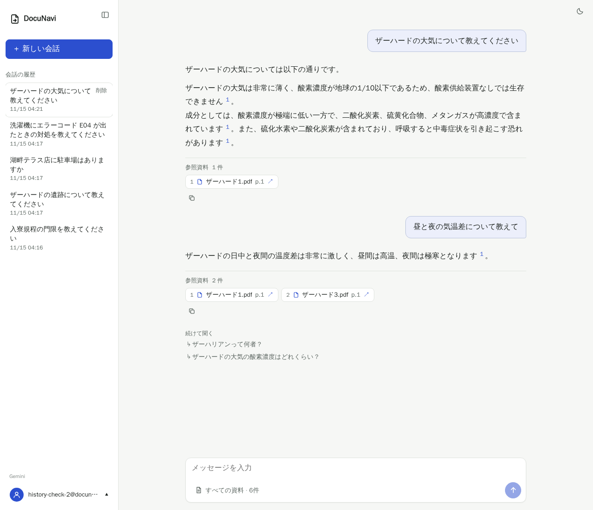
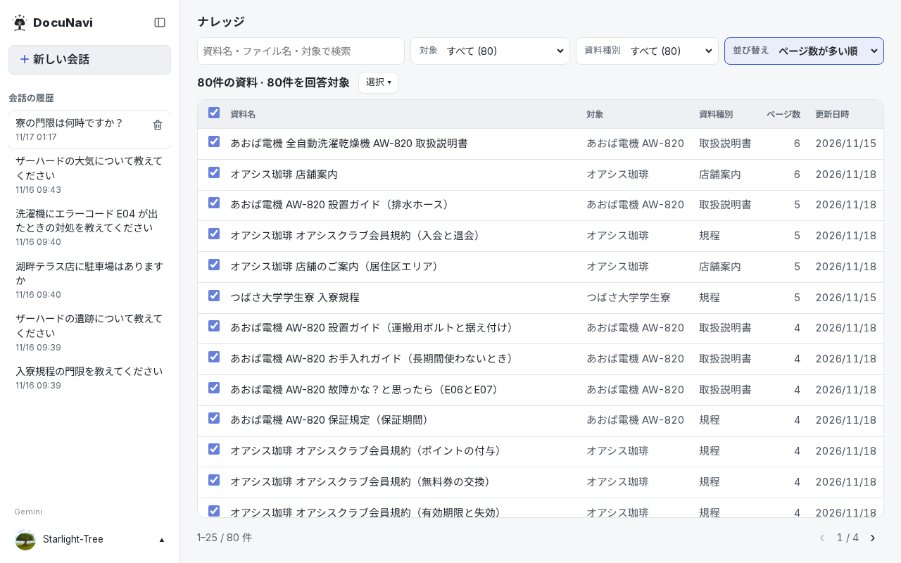
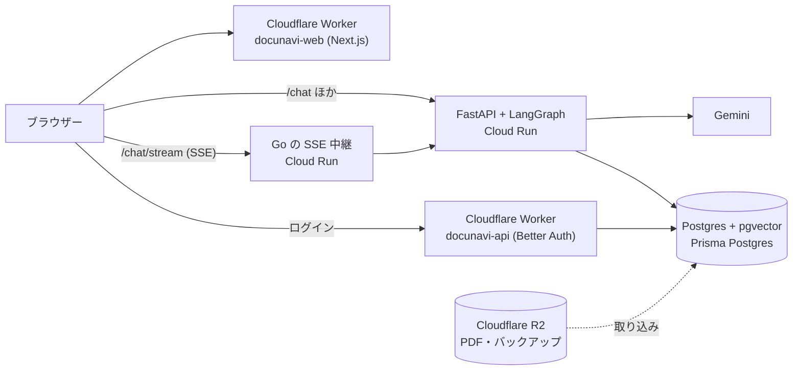

# ドキュナビ（DocuNavi）

[](https://github.com/Starlight-Tree/DocuNavi/actions/workflows/ci.yml)

[English](README.md) | 日本語

資料（PDF）を根拠に答える RAG チャットボットです（FastAPI、LangGraph、Gemini、Postgres + pgvector、Cloudflare Workers 上の Next.js）。回答には出典の番号が付き、押すと資料が開きます。
題材の資料（`storage/pdf/`）は架空のものです。

| チャット（出典と、続けて聞く候補つき） | 資料一覧（対象・資料種別で絞り込み、回答に使う資料を選ぶ） |
|---|---|
|  |  |

## 特徴

- **出典つきの回答。** `[n]` から根拠の資料とページを開けます。回答に使う資料を選べます。
- **測定した検索。** レイアウトを使ったチャンク分割、ハイブリッド検索（BM25 + pgvector）、リランク、GraphRAG。構成ごとの効果は `evals/` で測っています（[docs/search-design.md](docs/search-design.md)）。
- **ガードレール。** 入力と回答を検査し、ストリーミング中の漏洩も止めます。ルールベースで、プロンプトインジェクションを完全には防ぎません（[docs/guardrails.md](docs/guardrails.md)）。
- **LLM の不安定さへの対処。** ヘッジ、別モデルへのフォールバック、無料枠が尽きたときの有料キーへの切り替え（[docs/configuration.md](docs/configuration.md)）。
- **ロール別のアクセス制御とログイン。** 見える資料グループはロールで決まり、権限はサーバーが決めます。Better Auth（Google）の JWT を検証します。

## アーキテクチャ



質問は、入力ガード → エージェント（資料を検索するツール呼び出しのループ）→ 出力ガードの順に LangGraph で処理します。詳細は [docs/architecture.md](docs/architecture.md)。選んだ理由（学習のために入れた Go の中継を含む）は [docs/decisions/](docs/decisions/README.md)。

## Quick start

取り込んだ資料を Postgres（pgvector）で検索し、Gemini で回答します。環境変数 `DB_BACKEND=pg`、`DATABASE_URL`、`GEMINI_API_KEY` を読みます。設定の詳細は [docs/development.md](docs/development.md)、[docs/configuration.md](docs/configuration.md)。

```bash
# API（http://localhost:8000）
python -m venv .venv && source .venv/bin/activate
pip install -r requirements.txt
uvicorn app.main:app --reload

# 画面（別のターミナル。http://localhost:3000）
cd frontend && npm ci
cp .env.example .env.local   # 初回だけ
npm run dev
```

テスト: `pip install -r requirements-dev.txt && pytest` と `cd frontend && npm test`。テストはキーなしのモック（固定の返答、資料の検索なし）で動きます。

## ドキュメント

| 文書 | 内容 |
|---|---|
| [docs/README.md](docs/README.md) | 全文書の索引 |
| [docs/architecture.md](docs/architecture.md) | 処理の流れとディレクトリ構成 |
| [docs/configuration.md](docs/configuration.md) | 環境変数、LLM の遅延・失敗への対処 |
| [docs/api.md](docs/api.md) | API の仕様 |
| [docs/decisions/](docs/decisions/README.md) | 重要な決定と、その理由 |
| [evals/README.md](evals/README.md) | 評価の手順と結果 |

## このリポジトリについて

ポートフォリオとして公開している個人開発で、ガードレール、LLM の失敗への対処、ロール別の資料アクセス、測定した検索品質といった、本番運用の課題を試すために作りました。秘密情報と本番の資格情報は含みません。デプロイの仕組みを示すため、設定ファイルと運用の記録（`docs/deploy.md`）は含めています。パターンによる秘密の検査は、完全な保証ではありません。

## ライセンス

[MIT](LICENSE)
