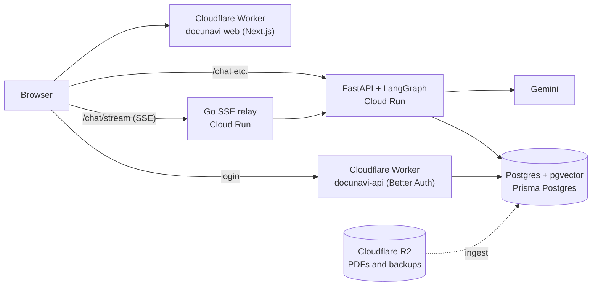

# DocuNavi

English | [日本語](README.ja.md)

DocuNavi is a RAG chatbot that answers questions from PDF documents and cites its sources (FastAPI, LangGraph, Gemini, Postgres + pgvector, Next.js on Cloudflare Workers).
It is a personal project built to explore production concerns: guardrails, LLM failure handling, role-based document access, and measured search quality.

Answers carry numbered citations; selecting one opens the source document.
The searchable documents live in `storage/pdf/<group name>/*.pdf`: setting documents for a fictional planet ("Zahard"), store guides for a fictional café chain, and a user manual and a dormitory regulation for fictional products.

| Chat (with citations and follow-up suggestions) | Document list (filter by group and type, choose which documents to use) |
|---|---|
|  |  |

The screenshots were taken with mock responses (the fake LLM and fake search used by the E2E tests, no real API). The answer text is not real.

## Features

- **Answers with citations.** The `[n]` marker at the end of a sentence opens the source document and page. You can choose which documents an answer may use.
- **Search design and measurement.** Headings, paragraphs and tables are rebuilt from the position of each character in the PDF and split into chunks, then searched with Postgres + pgvector. Hybrid search (BM25 + vectors), rule-based reranking and GraphRAG are layered on top, and the effect of each configuration is measured in `evals/` ([docs/search-design.md](docs/search-design.md), in Japanese).
- **Guardrails.** Input and finished answers are checked, and system-prompt leaks are detected incrementally and stopped while streaming. The guardrails are rule-based and do not fully prevent prompt injection (limits are described in [docs/guardrails.md](docs/guardrails.md)).
- **Handling unreliable LLM calls.** Slow calls are not waited for: extra attempts are launched in parallel (hedging). There is a fallback to another model and a switch to a paid key when the free tier is exhausted. A client disconnect is not counted as a failure; the LLM call is cancelled instead ([docs/configuration.md](docs/configuration.md)).
- **Role-based document access.** The groups of documents a user can see depend on their role. The server decides the permissions.
- **Login.** JWTs issued by Better Auth (Google login) are verified. Conversation history is stored per user.

## Architecture



A question is processed by LangGraph in this order: input guard → agent (a loop of tool calls that search the documents when needed) → output guard. Details are in [docs/architecture.md](docs/architecture.md).

Examples of design choices (decision records are in [docs/decisions/](docs/decisions/README.md)):

- **The UI and the API are on separate origins.** The UI is a browser-rendered SPA served from Cloudflare; the API runs on Cloud Run.
- **Only streaming goes through a Go relay.** The aim is to try out stable long-lived SSE connections, cancelling the upstream call on disconnect, and headroom for more concurrent connections. It was not added out of a product need; its purpose is learning and verification, and it has not been shown by measurement to be faster or more stable than the Python API ([decision 0005](docs/decisions/0005-go-sse-relay-without-prod-limit.md), [docs/go-architecture-plan.md](docs/go-architecture-plan.md)).

## Running it (mock mode, no real keys needed)

If `GEMINI_API_KEY` is not set, the app runs in mock mode: it does not search documents and returns a fixed reply. This is enough to check how the UI and the API connect.

```bash
# API (http://localhost:8000)
python -m venv .venv && source .venv/bin/activate
pip install -r requirements.txt
uvicorn app.main:app --reload

# UI (in another terminal, http://localhost:3000)
cd frontend && npm ci
cp .env.example .env.local   # first time only
npm run dev
```

```bash
curl -s localhost:8000/chat -H 'Content-Type: application/json' \
  -d '{"message": "Tell me about the atmosphere of Zahard"}'
```

A real LLM and real search need `DATABASE_URL` (a Postgres with the documents ingested and embedded) and `GEMINI_API_KEY` (or Vertex AI); see [docs/configuration.md](docs/configuration.md). For setups with Docker Compose, a dev container, or a local Postgres, see [docs/development.md](docs/development.md). The API reference is [docs/api.md](docs/api.md).

## Quality

- **Tests:** pytest (more than 3,300 collected; tests that need a DB or a real API are skipped when the environment is missing). The UI has Vitest (556 tests) and Playwright E2E tests (fake LLM, fake search).
- **CI:** GitHub Actions runs the backend, the UI (unit tests, type check, build), Go (`go vet`, `-race`), a type check of the auth Worker, a Docker build and start-up check, static analysis of the workflows (actionlint, zizmor), and a check of commit subjects. Actions are pinned by commit SHA, and Dependabot (weekly, 7-day cooldown, minor and patch updates grouped) proposes dependency updates.
- **Evaluation:** `evals/` holds comparisons of search configurations, GraphRAG, 50 exact-match questions, and answer evaluation (a golden set). Procedures and results are in [evals/README.md](evals/README.md).
- **Deployment:** releases to production are manual (`deploy.yml`, Cloud Build tags). Credentials are obtained through OIDC and are not stored in the repository.

```bash
pip install -r requirements-dev.txt
pytest                      # fixed to mock mode; no real API calls
cd frontend && npm test     # Vitest
```

## Documentation

The documents are written in Japanese.

| Document | Contents |
|---|---|
| [docs/architecture.md](docs/architecture.md) | Request flow, directory layout, environments |
| [docs/search-design.md](docs/search-design.md) | Search design and the conditions for revisiting it |
| [docs/guardrails.md](docs/guardrails.md) | Input and output guardrails (rejection conditions, incremental checks while streaming) |
| [docs/configuration.md](docs/configuration.md) | Environment variables; handling LLM latency, failures and disconnects |
| [docs/api.md](docs/api.md) | Specification of `/health`, `/chat`, `/chat/stream` and others, and errors |
| [docs/development.md](docs/development.md) | Development environment, tests, CI, dependency updates |
| [docs/deploy.md](docs/deploy.md) | Deployment steps and a log of production operations |
| [docs/roadmap.md](docs/roadmap.md) | Plans |
| [docs/decisions/](docs/decisions/README.md) | Important decisions and their reasons (one file each) |
| [docs/README.md](docs/README.md) | Index of all documents (marked as current state, design notes, or records) |
| [CLAUDE.md](CLAUDE.md) | Rules for the AI agent (Claude Code) |

## About this repository

- This is a personal project published as a portfolio. The sample documents are fictional.
- **It contains no secrets (API keys, tokens, connection strings, passwords).** Values are kept in environment variables outside Git and in secret management (Infisical). Commits are checked for secret patterns and registered terms. Pattern-based checks are not a complete guarantee.
- **It contains no production credentials and no settings that exist only in production.** To show how deployment works, the repository includes configuration files (`cloudbuild*.yaml`, `wrangler.jsonc`, `.github/workflows/`) and operation records (such as `docs/deploy.md`). The records state the date of each action, and what was and was not confirmed.

## License

[MIT](LICENSE)
