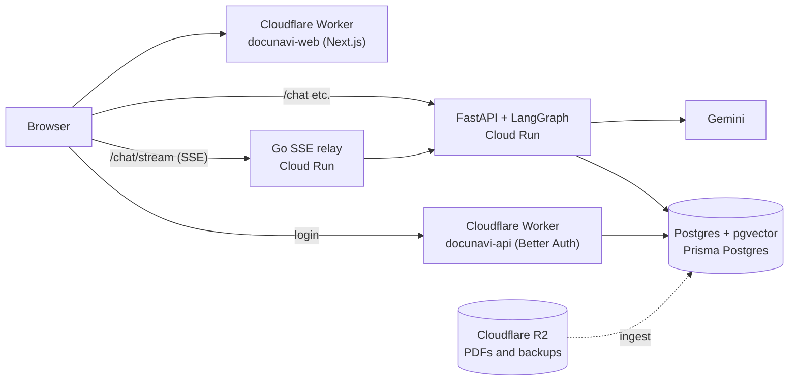

# DocuNavi

[](https://github.com/Starlight-Tree/DocuNavi/actions/workflows/ci.yml)

English | [日本語](README.ja.md)

DocuNavi is a RAG chatbot that answers questions from PDF documents and cites its sources (FastAPI, LangGraph, Gemini, Postgres + pgvector, Next.js on Cloudflare Workers).
The sample documents (`storage/pdf/`) are fictional.

| Chat (cited sources under each answer, follow-up suggestions, a two-turn conversation with history) | Document list (filter by target and type, choose which documents to answer from) |
|---|---|
|  |  |

## Features

- **Answers with citations.** The "N sources" button under each answer opens the source document and page. You choose which documents an answer may use.
- **Measured search.** Layout-aware chunking, hybrid search (BM25 + pgvector), reranking and GraphRAG; each configuration is evaluated in `evals/` ([docs/search-design.md](docs/search-design.md)).
- **Guardrails.** Input and answers are checked, including prompt leaks while streaming. Rule-based, so not a full defense against prompt injection ([docs/guardrails.md](docs/guardrails.md)).
- **Resilient LLM calls.** Hedged requests, model fallback, and a paid-key switch when the free tier runs out ([docs/configuration.md](docs/configuration.md)).
- **Role-based access and login.** Document groups depend on the user's role, decided by the server. Better Auth (Google) JWTs are verified.

## Architecture



A question goes through LangGraph: input guard → agent (tool-call loop that searches the documents) → output guard. See [docs/architecture.md](docs/architecture.md). Why things are built this way (including the Go relay, which is there for learning): [docs/decisions/](docs/decisions/README.md).

## Quick start

The app searches the ingested documents in Postgres (pgvector) and answers with Gemini. It reads `DB_BACKEND=pg`, `DATABASE_URL` and `GEMINI_API_KEY` from the environment. Setup details: [docs/development.md](docs/development.md), [docs/configuration.md](docs/configuration.md).

```bash
# API (http://localhost:8000)
python -m venv .venv && source .venv/bin/activate
pip install -r requirements.txt
uvicorn app.main:app --reload

# UI (another terminal, http://localhost:3000)
cd frontend && npm ci
cp .env.example .env.local   # first time only
npm run dev
```

Tests: `pip install -r requirements-dev.txt && pytest` and `cd frontend && npm test`. Tests run without keys, in a mock mode (fixed replies, no document search).

## Documentation

The documents are written in Japanese.

| Document | Contents |
|---|---|
| [docs/README.md](docs/README.md) | Index of all documents |
| [docs/features.md](docs/features.md) | Feature list with conditions and limits |
| [docs/architecture.md](docs/architecture.md) | Request flow and directory layout |
| [docs/configuration.md](docs/configuration.md) | Environment variables; handling of LLM latency and failures |
| [docs/api.md](docs/api.md) | API reference |
| [docs/testing.md](docs/testing.md) | How to run the tests, main scenarios, what is unverified |
| [docs/decisions/](docs/decisions/README.md) | Important decisions and their reasons |
| [evals/README.md](evals/README.md) | Evaluation procedures and results |

## About this repository

A personal project published as a portfolio, built to explore production concerns: guardrails, LLM failure handling, role-based document access, and measured search quality. It contains no secrets and no production credentials; configuration files and operation records (`docs/deploy.md`) are included to show how deployment works. Pattern-based secret checks are not a complete guarantee.

## License

[MIT](LICENSE)
