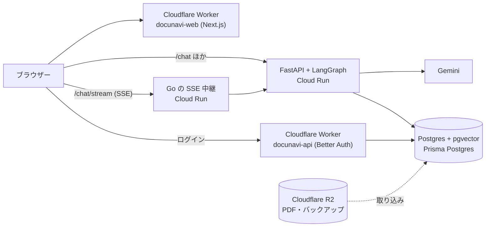

# ドキュナビ（DocuNavi）

> **DocuNavi** is a RAG chatbot that answers questions from PDF documents and cites its sources (FastAPI, LangGraph, Gemini, Postgres + pgvector, Next.js on Cloudflare Workers).
> It is a personal project built to explore production concerns: guardrails, LLM failure handling, role-based document access, and measured search quality. Docs are in Japanese.

資料（PDF）を根拠に答える RAG チャットボットです。回答には出典の番号が付き、押すと資料が開きます。
検索する資料は `storage/pdf/<資料群の名前>/*.pdf` で、架空の惑星「ザーハード」の設定資料、架空のカフェチェーンの店舗案内、架空の家電の取扱説明書・学生寮の入寮規程があります。

| チャット（出典と、続けて聞く候補つき） | 資料一覧（対象・資料種別で絞り込み、回答に使う資料を選ぶ） |
|---|---|
|  |  |

画面は、実 API を使わないモックの応答（E2E 用の偽の LLM・偽の検索）で撮ったものです。回答の文面は本物ではありません。

## 特徴

- **出典つきの回答。** 文末の番号 `[n]` から、根拠の資料とページを開けます。資料ごとに、回答に使うかを選べます。
- **検索の設計と測定。** PDF の文字の位置から見出し・段落・表を組み立ててチャンクにし、Postgres + pgvector で検索します。ハイブリッド（BM25 + ベクトル）・ルールベースのリランク・GraphRAG を重ね、構成ごとの効果は `evals/` で測っています（[docs/search-design.md](docs/search-design.md)）。
- **ガードレール。** 入力と完成した回答を検査し、ストリーミング中も、システムプロンプトの漏洩を逐次検知して止めます。ルールベースで、プロンプトインジェクションを完全には防ぎません（限界は [docs/guardrails.md](docs/guardrails.md)）。
- **LLM の不安定さへの対処。** 遅い呼び出しは待たずに追加の試行を投げ（ヘッジ）、別モデルへのフォールバックと、無料枠が尽きたときの有料キーへの切り替えを備えます。切断は失敗として数えず、LLM の呼び出しを取り消します（[docs/configuration.md](docs/configuration.md)）。
- **ロール別の資料アクセス制御。** 利用者のロールに応じて、見える資料グループを制限します。権限はサーバーが決めます。
- **ログイン。** Better Auth（Google ログイン）が発行した JWT を検証します。履歴は利用者ごとに分けて保存します。

## アーキテクチャ



質問は、入力ガード → エージェント（必要なら資料を検索するツール呼び出しのループ）→ 出力ガードの順に LangGraph で処理します。詳細は [docs/architecture.md](docs/architecture.md)。

選んだ理由の例（決定の記録は [docs/decisions/](docs/decisions/README.md)）:

- **画面と API を別オリジンにした。** 画面はブラウザーだけで描く SPA にして Cloudflare で配信し、API は Cloud Run に置いています。
- **ストリーミングだけ Go の中継を通す。** 長い SSE 接続の安定、切断時の上流の取り消し、同時接続が増えたときの備えを試すためです。製品上の必要から入れたものではなく、学習と検証が目的で、Python の API より速い・安定するとは測定で示せていません（[決定 0005](docs/decisions/0005-go-sse-relay-without-prod-limit.md)、[docs/go-architecture-plan.md](docs/go-architecture-plan.md)）。

## 動かす（モックモード。実キー不要）

`GEMINI_API_KEY` が未設定なら、資料を検索せず固定の返答を返すモックモードで動きます。画面と API のつなぎ目を確かめられます。

```bash
# API（http://localhost:8000）
python -m venv .venv && source .venv/bin/activate
pip install -r requirements.txt
uvicorn app.main:app --reload

# 画面（別のターミナル。http://localhost:3000）
cd frontend && npm ci
cp .env.example .env.local   # 初回だけ
npm run dev
```

```bash
curl -s localhost:8000/chat -H 'Content-Type: application/json' \
  -d '{"message": "ザーハードの大気について教えて"}'
```

本物の LLM と検索には、`DATABASE_URL`（資料を取り込み・埋め込み済みの Postgres）と `GEMINI_API_KEY`（または Vertex AI）が要ります（[docs/configuration.md](docs/configuration.md)）。Docker Compose・開発コンテナ・ローカルの Postgres を使う構成は [docs/development.md](docs/development.md)、API の仕様は [docs/api.md](docs/api.md)。

## 品質の取り組み

- **テスト:** pytest（3,300 件超を収集。DB や実 API が要るものは、環境が無ければスキップ）、画面は Vitest（556 件）と Playwright の E2E（偽の LLM・偽の検索）。
- **CI:** GitHub Actions で、バックエンド・画面（単体・型検査・ビルド）・Go（`go vet`、`-race`）・認証 Worker の型検査・Docker のビルドと起動確認・ワークフローの静的検査（actionlint、zizmor）・コミット件名の検査を行います。アクションはコミット SHA で固定し、依存の更新は Dependabot（週次・7 日待ち・minor と patch をまとめる）が出します。
- **評価:** `evals/` に、検索の構成の比較、GraphRAG、完全一致の質問 50 問、回答の評価（ゴールデンセット）を置いています。測定の手順と結果は [evals/README.md](evals/README.md)。
- **デプロイ:** 本番への反映は手動（`deploy.yml`、Cloud Build のタグ）です。資格情報は OIDC で取得し、リポジトリには置きません。

```bash
pip install -r requirements-dev.txt
pytest                      # モックモード固定。実 API は呼ばない
cd frontend && npm test     # Vitest
```

## ドキュメント

| 文書 | 内容 |
|---|---|
| [docs/architecture.md](docs/architecture.md) | 処理の流れ、ディレクトリ構成、環境構成 |
| [docs/search-design.md](docs/search-design.md) | 検索の設計と、見直す条件 |
| [docs/guardrails.md](docs/guardrails.md) | 入出力ガードレール（拒否の条件、ストリーミング中の逐次検査） |
| [docs/configuration.md](docs/configuration.md) | 環境変数、LLM の遅延・失敗・切断への対処 |
| [docs/api.md](docs/api.md) | `/health`・`/chat`・`/chat/stream` ほかの仕様、エラー |
| [docs/development.md](docs/development.md) | 開発環境、テスト、CI、依存の更新 |
| [docs/deploy.md](docs/deploy.md) | デプロイ手順と本番運用の記録 |
| [docs/roadmap.md](docs/roadmap.md) | これからの計画 |
| [docs/decisions/](docs/decisions/README.md) | 重要な決定と、その理由（1 件 1 ファイル） |
| [docs/README.md](docs/README.md) | 全文書の索引（現状・設計メモ・記録の別つき） |
| [CLAUDE.md](CLAUDE.md) | AI エージェント（Claude Code）が守ること |

## このリポジトリについて

- ポートフォリオとして公開している個人開発のリポジトリです。題材の資料は架空のものです。
- **秘密情報（API キー・トークン・接続文字列・パスワード）は含みません。** 値は、Git 管理外の環境変数と、シークレット管理（Infisical）に置いています。コミット時に、秘密のパターンと登録語の検査をしています。ただし、パターンによる検査は完全な保証ではありません。
- **本番の資格情報や、本番にだけある設定値は含みません。** デプロイの仕組みを示すために、設定ファイル（`cloudbuild*.yaml`、`wrangler.jsonc`、`.github/workflows/`）と運用の記録（`docs/deploy.md` など）は含めています。記録には、実行した日付と、確認できたこと・できていないことを書いています。

## ライセンス

[MIT](LICENSE)
