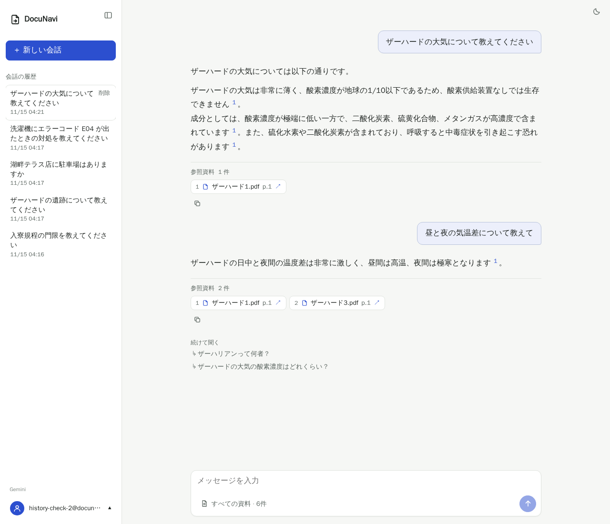
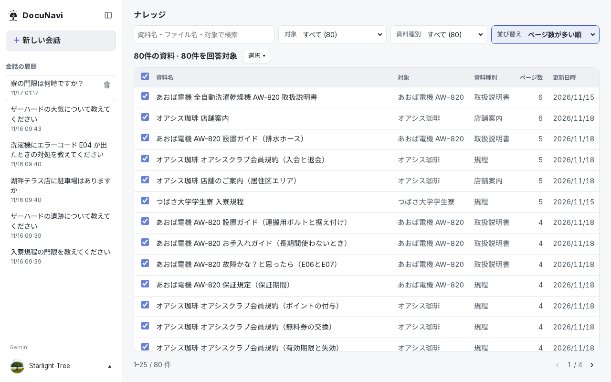
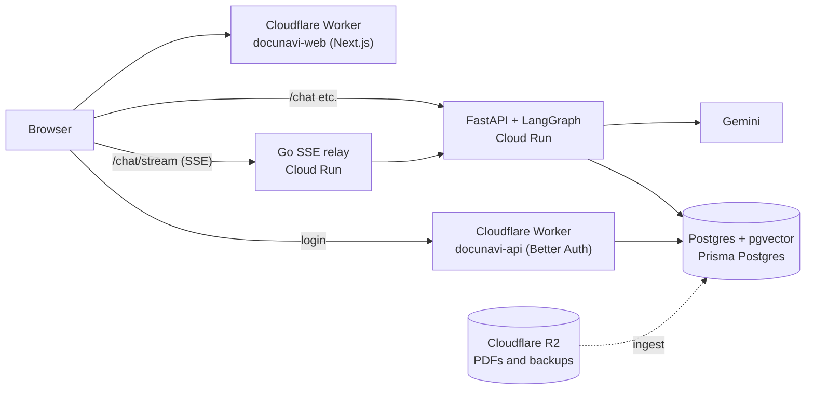

# DocuNavi

[](https://github.com/Starlight-Tree/DocuNavi/actions/workflows/ci.yml)

English | [日本語](README.ja.md)

DocuNavi is a RAG chatbot that answers questions from PDF documents and cites its sources (FastAPI, LangGraph, Gemini, Postgres + pgvector, Next.js on Cloudflare Workers).
It is a personal project built to explore production concerns: guardrails, LLM failure handling, role-based document access, and measured search quality.
The sample documents (`storage/pdf/`) are fictional.

| Chat (with citations and follow-up suggestions) | Document list (filter by group and type, choose which documents to use) |
|---|---|
|  |  |

## Features

- **Answers with citations.** A `[n]` marker opens the source document and page. You choose which documents an answer may use.
- **Measured search.** Layout-aware chunking, hybrid search (BM25 + pgvector), reranking and GraphRAG; each configuration is evaluated in `evals/` ([docs/search-design.md](docs/search-design.md)).
- **Guardrails.** Input and answers are checked, including prompt leaks while streaming. Rule-based, so not a full defense against prompt injection ([docs/guardrails.md](docs/guardrails.md)).
- **Resilient LLM calls.** Hedged requests, model fallback, and a paid-key switch when the free tier runs out ([docs/configuration.md](docs/configuration.md)).
- **Role-based access and login.** Document groups depend on the user's role, decided by the server. Better Auth (Google) JWTs are verified.

## Architecture



A question goes through LangGraph: input guard → agent (tool-call loop that searches the documents) → output guard. See [docs/architecture.md](docs/architecture.md). Why things are built this way (including the Go relay, which is there for learning): [docs/decisions/](docs/decisions/README.md).

## Quick start (mock mode, no real keys)

Without `GEMINI_API_KEY` the app runs in mock mode: no document search, a fixed reply. It is enough to see how the UI and the API connect.

```bash
# API (http://localhost:8000)
python -m venv .venv && source .venv/bin/activate
pip install -r requirements.txt
uvicorn app.main:app --reload

# UI (another terminal, http://localhost:3000)
cd frontend && npm ci
cp .env.example .env.local   # first time only
npm run dev
```

Tests: `pip install -r requirements-dev.txt && pytest` (mock mode, no real API calls) and `cd frontend && npm test`.

A real LLM and real search need `DATABASE_URL` and `GEMINI_API_KEY` ([docs/configuration.md](docs/configuration.md)). Docker, dev container and local Postgres setups: [docs/development.md](docs/development.md). API reference: [docs/api.md](docs/api.md).

## Documentation

The documents are written in Japanese. Start with [docs/README.md](docs/README.md) (index), [docs/architecture.md](docs/architecture.md), [docs/configuration.md](docs/configuration.md) and [docs/decisions/](docs/decisions/README.md). Evaluation procedures and results: [evals/README.md](evals/README.md).

## About this repository

A personal project published as a portfolio. It contains no secrets and no production credentials; configuration files and operation records (`docs/deploy.md`) are included to show how deployment works. Pattern-based secret checks are not a complete guarantee.

## License

[MIT](LICENSE)
