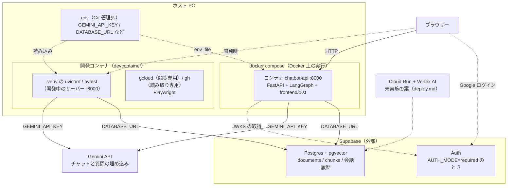
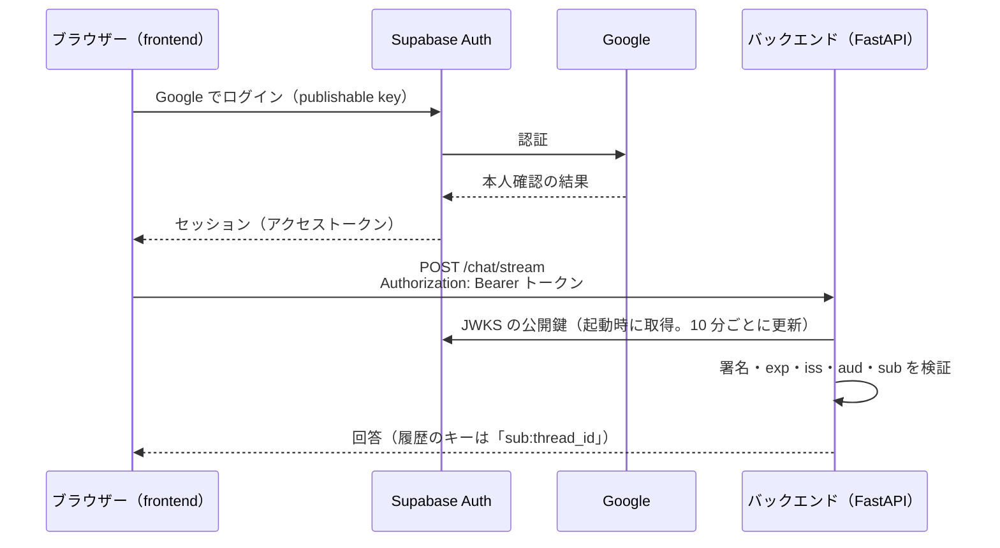

# アーキテクチャ

質問は、入力ガード → LLM（必要なら資料の検索）→ 出力ガードの順に処理されます。API の仕様は [api.md](api.md)、環境変数は [configuration.md](configuration.md) にあります。

## 質問はどう処理されるか

`app/agents/graph.py` の LangGraph は、次の順に進みます。

- `guard_input` が入力を拒否したときは、LLM もツールも呼ばずに END へ進みます。
- `agent` は Gemini（キーが無ければモック）を呼びます。ツール呼び出しがあれば `tools`（資料の検索）へ進み、結果を持って `agent` に戻ります。
- `guard_output` が最終回答を検査して終了します。
- `POST /chat/stream` だけは、`agent` が LLM の応答をチャンクごとに受け（`stream_tokens` が真のとき）、逐次ガードを通した本文をカスタム
  ストリームへ流します。`/chat`（`ainvoke`）の経路は変わりません。ヘッジは「最初のチャンクが届いた試行」を採ります（`hedged_stream`）。

## どこに何があるか

| パス | 役割 |
|---|---|
| `app/main.py` | FastAPI アプリ（CORS、例外ハンドラ） |
| `app/api/routes.py` | `/health`、`/chat`、`/chat/stream`、入力検証、LLM・履歴の保存先のエラーの分類、切断時の取り消し |
| `app/api/ui_stream.py` | `/chat/stream` の応答（AI SDK の UI message stream）の組み立て |
| `app/history.py` | 会話履歴の保存先（`DATABASE_URL` があれば Postgres、無ければメモリ）。接続プールの開閉 |
| `app/frontend.py` | `frontend/dist` の配信と SPA フォールバック |
| `app/agents/graph.py` | LangGraph のグラフ、`SYSTEM_PROMPT`、モック LLM |
| `app/agents/guardrails.py` | 入出力ガードレール（[guardrails.md](guardrails.md)） |
| `app/agents/resilience.py` | LLM 呼び出しのヘッジ付き再試行（完了を待つ `hedged_call` と、最初のチャンクを待つ `hedged_stream`） |
| `app/agents/tools.py` | 資料の検索ツール（`search_documents`）。実体は `search_vector.py`（DB のベクトル検索。失敗しても別の経路に戻らない） |
| `app/search_vector.py` | 質問の埋め込みと pgvector のコサイン類似度検索、起動時の DB の検査（設計: [search-design.md](search-design.md)） |
| `app/ingestion/` | PDF の取り込み（`python -m app.ingestion`）と埋め込み（`python -m app.ingestion.embed`）。`corpus.py` は評価の BM25 基準線用 |
| `frontend/` | チャット画面（Vite + React + TypeScript）。`dist/` がビルド成果物 |
| `storage/pdf/<名前>/` | PDF の資料（取り込みの元。検索は DB を読む。ディレクトリ名は整理用。いまは zahard・cafe・guides） |
| `scripts/` | 評価の道具。`bm25_baseline.py` は、以前アプリが使った BM25（評価の基準線。アプリは使わない） |
| `tests/` | pytest（モックモード固定） |

会話履歴は `thread_id` ごとに保持します。`DATABASE_URL` が空ならプロセス内メモリ（`MemorySaver`）で、再起動で消え、複数ワーカー間では
共有されません。設定すると Postgres に保存します（`app/history.py`。起動時にプールを開き、終了時に閉じる。
[configuration.md](configuration.md) の「会話履歴の保存先」）。

## どこで動くか

何がどこで動き、どこと通信するかの図です。破線は、条件つきの通信と、未実施の案です。

- アプリの実行は 2 通りです。ホストでの `docker compose up`（`chatbot-api`）と、開発コンテナの `.venv` での `uvicorn`。どちらも 8000 番を使います。
  開発コンテナには Docker が無いので、compose はホスト側で実行します。
- 検索（`chunks`）と会話履歴は、同じ `DATABASE_URL` の DB です。本物の LLM では `DATABASE_URL` と `GEMINI_API_KEY` が必須で、
  無いとモックモード（キー未設定）か、起動の失敗になります（[search-design.md](search-design.md)）。
- 秘密情報の置き場所は、実行時の環境変数だけです。値は文書にも画像にも書きません。
  - `GEMINI_API_KEY`、`DATABASE_URL`: ホストのリポジトリ直下の `.env`（Git 管理外。雛形は `.env.example`）。compose が `env_file` で渡します。
  - `VITE_SUPABASE_PUBLISHABLE_KEY`: 画面のビルド時に渡す公開用の値で、秘密ではありません。
  - gh の読み取り専用トークン: 開発コンテナの名前付きボリューム（`~/.gh-config`）。gcloud のログインは残しません（[.devcontainer/README.md](../.devcontainer/README.md)）。
- Cloud Run と Vertex AI は、手順を書いただけで、実行も検証もしていません（[deploy.md](deploy.md)）。

## ログインの流れ

`AUTH_MODE=required` のときの流れです（仕様は [configuration.md](configuration.md) の「ログイン（認証）」）。ブラウザーが Supabase Auth でログインして
アクセストークン（JWT）を受け取り、API にはそのトークンだけを送ります。バックエンドは、Supabase が公開する鍵で署名を検証します。

- **信頼の境界。** バックエンドが信じるのは、検証に通ったトークンの `sub` だけです。クライアントが送る `thread_id` や、画面の状態は信じません。
- **秘密と公開の区別。** 画面に渡すのは Supabase の URL と publishable key だけです（公開してよい値）。Gemini のキーと DB の接続 URL は、バックエンドの環境変数にだけあります。
- **401 のとき。** 画面は、トークンの更新を 1 回試し、だめならログインを促す固定の文を出します。ログイン前の画面（`?tab=documents` など）は、ログイン後に元へ戻ります。
- **確認の状況。** ローカルで、Google ログイン → 画面に戻る → 質問を送る、を実際の Supabase で通しました（2026-10-19）。本番の環境（Cloud Run）では未確認です。

## 画面はどう配信されるか

`app/frontend.py` が `frontend/dist` を配信します。どのルートにも当たらなかった `GET`/`HEAD` だけが画面側に回り、拡張子のないパスは
`index.html`（SPA のルーティング）、無いファイル（`/assets` 配下や拡張子付き）は 404 になります。`/chat`・`/chat/stream`・`/health`・`/docs` などの API は
影響を受けません。

## ガードレールはどう働くか

ルールベース（LLM を使わない）で、入力は拒否と伏せ字、出力は `SYSTEM_PROMPT` の漏洩の検査（ストリーミング中は逐次）を行います。
典型的な手口を安く弾くためのもので、プロンプトインジェクションを完全に防ぐものではありません。詳細は [guardrails.md](guardrails.md) です。
