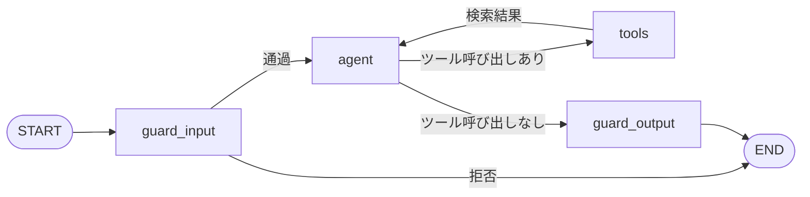
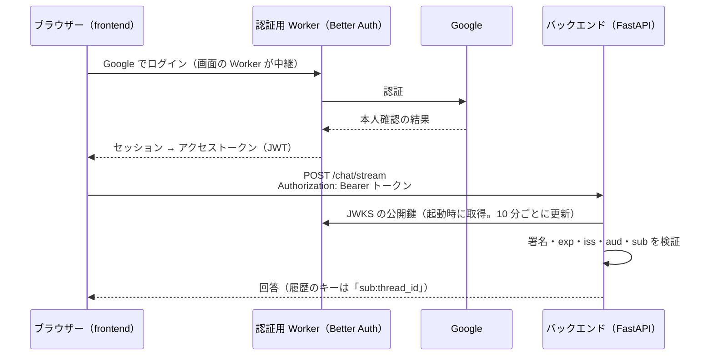

# アーキテクチャ

質問は、入力ガード → LLM（必要なら資料の検索）→ 出力ガードの順に処理されます。API の仕様は [api.md](api.md)、環境変数は [configuration.md](configuration.md) にあります。

## 質問はどう処理されるか

`app/agents/graph.py` の LangGraph は、次の順に進みます。

- `guard_input` が入力を拒否したときは、LLM もツールも呼ばずに END へ進みます。
- `agent` は Gemini（キーが無ければモック）を呼びます。ツール呼び出しがあれば `tools`（資料の検索）へ進み、結果を持って `agent` に戻ります。
- `guard_output` が最終回答を検査して終了します。
- `POST /chat/stream` だけは、`agent` が LLM の応答をチャンクごとに受け（`stream_tokens` が真のとき）、逐次ガードを通した本文をカスタム
  ストリームへ流します。`/chat`（`ainvoke`）の経路は変わりません。ヘッジは「最初のチャンクが届いた試行」を採ります（`hedged_stream`）。

## どこに何があるか

| パス | 役割 |
|---|---|
| `app/main.py` | FastAPI アプリ（CORS、例外ハンドラ） |
| `app/api/routes.py` | `/health`、`/chat`、`/chat/stream`、入力検証、LLM・履歴の保存先のエラーの分類、切断時の取り消し |
| `app/api/ui_stream.py` | `/chat/stream` の応答（AI SDK の UI message stream）の組み立て |
| `app/history.py` | 会話履歴の保存先（`DB_BACKEND=pg` なら Postgres〔`app/pg.py`・`app/pg_saver.py`〕、空ならメモリ。旧経路の `d1` はテスト用に残してある）。接続の開閉 |
| `app/agents/graph.py` | LangGraph のグラフ、`SYSTEM_PROMPT`、モック LLM |
| `app/agents/guardrails.py` | 入出力ガードレール（[guardrails.md](guardrails.md)） |
| `app/agents/resilience.py` | LLM 呼び出しのヘッジ付き再試行（完了を待つ `hedged_call` と、最初のチャンクを待つ `hedged_stream`） |
| `app/agents/tools.py` | 資料の検索ツール（`search_documents`）。実体は `app/search/vector.py`（Postgres + pgvector の検索。失敗しても別の経路に戻らない） |
| `app/access.py`・`app/scope.py` | ロール別の資料グループ制御（`ACCESS_MODE`。[configuration.md](configuration.md) の「資料グループのアクセス制御」）。`Scope` は検索できるグループの範囲で、検索は渡し忘れを許さない |
| `app/search/` | 資料の検索。`pipeline.py`（入口。フラグでハイブリッド・リランカー・GraphRAG を重ねる）、`vector.py`（質問の埋め込みと pgvector のコサイン類似度検索、起動時の DB の検査。設計: [search-design.md](search-design.md)）、`keyword.py`（BM25）、`rerank.py`、`graph.py`、`types.py`（`Hit` と `VectorSearchError`） |
| `app/ingestion/` | PDF の取り込み（`python -m app.ingestion`）と埋め込み（`python -m app.ingestion.embed`）。`corpus.py` は評価の BM25 基準線用。ページは通し番号（`page`）と PDF のページラベル（`page_label`）を分けて持つ（下の「ページの番号とラベル」） |
| `db/` | `migrations/`（SQL を番号順に。`migrate.py` が適用する。`0002` は `chunks.page_label` `page_end_label`）、`seeds/`、`local-init/` |
| `frontend/` | チャット画面（Next.js + React + TypeScript）。Cloudflare の Worker `docunavi-web`（OpenNext）が配信する（FastAPI は配信しない）。E2E もここ |
| `storage/pdf/<名前>/` | PDF の資料（取り込みの元。検索は Postgres を読む。ディレクトリ名は整理用。いまは zahard・cafe・guides） |
| `scripts/` | 評価の道具。`bm25_baseline.py` は、以前アプリが使った BM25（評価の基準線。アプリは使わない） |
| `tests/` | pytest（モックモード固定） |
| `ops/` | 運用・補助のサービス。`sse-relay/`（Go の SSE 中継）と `sse-fake-upstream/`（その負荷試験用の疑似の上流）、`mcp_search/`（MCP の検索。読み取り専用）と `mcp_probe/`（MCP のつなぎ方の検証用）、`budget_guard/`（予算が上限に届いたら課金を止める）と `budget_guard_disarm/`（その承認トークンの発行）、`r2_key_issuer/`（R2 のキーの発行・取り消し Job）と `r2_wire/`（R2 参照への切り替え Job）、`django-saas/`（Django の学習用の試作。製品には入っていない） |
| `docs/` `.claude/` | 文書（`docs/CLAUDE.md` に正本の表。決定の記録は `docs/decisions/`）と、Claude Code 用の規約（`CLAUDE.md` は領域ごと、`.claude/rules/` は領域別の規則、`.claude/skills/` は手順） |

会話履歴は `thread_id` ごとに保持します。DB を設定しない（`DATABASE_URL` が空）ときはプロセス内メモリ（`MemorySaver`）で、再起動で消え、複数ワーカー間では
共有されません。`DB_BACKEND=pg` と `DATABASE_URL` を設定すると Postgres に保存します（`app/history.py`、`app/pg_saver.py`。起動時に接続を開き、終了時に閉じる。
開けないときは、メモリへ切り替えず起動を失敗させる。[configuration.md](configuration.md) の「会話履歴の保存先」）。

## ページの番号とラベル

表紙・目次のある PDF では、何枚目か（通し番号）と、紙面の番号（ラベル）が違うので、チャンクは両方を持ちます（決定: [decisions/0010](decisions/0010-physical-page-number-and-display-label.md)）。

| | 列・項目 | 使い道 |
|---|---|---|
| 通し番号 | `chunks.page`・`page_end`（1 始まり） | 元の PDF を開くリンク（`#page=N`）、評価の根拠ページの照合 |
| 表示ラベル | `chunks.page_label`・`page_end_label`（PDF の `/PageLabels`。「表紙」「i」「1」「A-1」など） | 画面の出典・チャンクの表示だけ |

- 取り込み（`pdf_parser._page_labels`）がラベルを読み、`chunker` がチャンクに付けます。ラベルが無い・壊れた PDF は `NULL`（表示は通し番号）で、取り込みは止まりません。
- 内容のハッシュにラベルは含めません。再取り込みすると、同じハッシュのチャンクも `UPDATE` でラベルが入ります（再埋め込みはしません）。
- 列は `NULL` 可の追加です。**配備は、マイグレーション（`db/migrate.py --apply`）を先に、Cloud Run と取り込みを後に。** 逆だと検索の SQL が列を名指しして 503 になります。2026-11-15 時点で、本番には未適用です。
- 関係図（`app/relations/`）は、ラベルが数字でないページ（表紙・目次）を読みません。

## どこで動くか

本番環境（Cloud Run + Cloudflare Workers〔画面・認証〕+ Cloudflare R2 + Prisma Postgres + Gemini）およびローカル開発環境の構成と通信経路です。
**2026-11-08 から、本番のデータ（資料・チャンク・埋め込み・会話履歴・認証）は、Prisma Postgres（Free・東京。pgvector で検索）に置く。** FastAPI・MCP・取り込み／履歴削除の Job は `DATABASE_URL` で直接つなぐ。認証は、Worker `docunavi-api`（Better Auth）が Hyperdrive 経由で同じ Postgres を使う。
バックアップは、R2 への週 1 回の `pg_dump` です（[pg-backup.md](pg-backup.md)）。
本番の Cloud Run には `GOOGLE_GENAI_USE_VERTEXAI` の設定が無く（2026-10-31 に確認）、Vertex AI は使っていません。LiteLLM などの LLM ゲートウェイは通っていません
（LiteLLM gateway is removed and no longer used.）。Gemini CLI is not part of the docunavi runtime。

```mermaid
flowchart TB
    browser["ブラウザー"]

    subgraph cfweb["Cloudflare Workers（本番フロントエンド）"]
        frontend["Next.js（frontend/）<br/>https://docunavi-web.wataru-apps.workers.dev"]
    end

    subgraph gcp["GCP Cloud Run（本番バックエンド）"]
        sserelay["docunavi-sse-relay<br/>Go SSE 中継（:8080）"]
        api_prod["docunavi<br/>FastAPI + LangGraph（h2c）"]
        mcp["docunavi-mcp<br/>MCP 検索ツール"]
        jobs["Cloud Run Jobs<br/>history-cleanup / ingest-sync / ingest-queue"]
    end

    subgraph host["ローカル開発環境"]
        subgraph compose["docker compose"]
            c_front["frontend :3000<br/>（Next.js dev）"]
            c_api["docunavi-api<br/>（FastAPI。DB につながず、モックモード）"]
        end
        subgraph devc["開発コンテナ（devcontainer）"]
            venv[".venv（uvicorn :8000 / pytest）"]
            dev_tools["Claude Code<br/>Playwright"]
        end
    end

    subgraph cfauth["Cloudflare（認証用 Worker）"]
        authworker["Worker docunavi-api<br/>Better Auth（/api/auth/*）<br/>Hyperdrive 経由で Postgres へ"]
    end

    subgraph data["データ（Prisma Postgres）"]
        pg["Postgres + pgvector<br/>documents / chunks / 履歴 / 認証"]
    end

    subgraph cloudflare["Cloudflare R2（原本ストレージ）"]
        r2["docunavi-documents<br/>PDF 原本"]
    end

    subgraph llm["LLM（モデル生成・埋め込み）"]
        gemini["Gemini API<br/>主: gemini-3.1-flash-lite（コード既定）<br/>副: gemini-3.5-flash-lite<br/>埋め込み: gemini-embedding-2"]
    end

    %% 本番の通信経路
    browser -->|画面表示| frontend
    browser -->|POST /chat/stream| sserelay
    sserelay -->|h2c 中継| api_prod
    browser -->|GET /documents, POST /chat 等| api_prod
    browser -.->|Google ログイン<br/>（画面の Worker が /api/auth/* を中継）| authworker

    api_prod -->|DATABASE_URL| pg
    api_prod -->|JWKS 取得| authworker
    api_prod -->|原本取得| r2
    api_prod -->|推論・埋め込み| gemini

    authworker --> pg
    mcp -->|検索クエリ| pg
    jobs -->|定期バッチ| pg
    jobs -->|取り込み| r2

    %% 開発時の通信経路
    browser -.->|開発時| c_front
    c_front -.->|rewrites| c_api
    devc -.-> gemini
```

- 本番環境では、Cloud Run 上で複数のサービス（FastAPI 本体、Go SSE 中継、MCP 検索、各種バッチ Job）と Cloudflare の Worker `docunavi-web` 上の Next.js 画面が稼働し、Cloudflare の認証用 Worker（Better Auth）、Prisma Postgres（資料・チャンク・履歴・認証）、Cloudflare R2（PDF 原本・バックアップ）、Gemini API（主: gemini-3.1-flash-lite〔コード既定〕、副: gemini-3.5-flash-lite、埋め込み: gemini-embedding-2）と連携しています（デプロイ実績と運用手順は [deploy.md](deploy.md)）。
- ローカル開発でのアプリ実行は 3 通りです。ホストでの `docker compose up`（`docunavi-api`。DB につながず、モックモードで動く。ポートは公開せず、`docunavi-frontend`（next dev）の 3000 番経由で使う。
  8000 番は `docker-compose.api-port.yml` を重ねたときだけ）、開発コンテナの `.venv` での `uvicorn`（8000 番）、そしてローカルの Postgres と認証までそろえる標準構成（`scripts/dev-local.sh`。本番の DB には接続しない。
  [development.md](development.md) の「ローカルの標準構成」）です。開発コンテナには Docker が無いので、compose はホスト側で実行します。
  開発コンテナ自体も Compose ベースで（`.devcontainer/docker-compose.yml`）、2026-11-11 から、開いても `api` `frontend` は起動しません
  （[.devcontainer/README.md](../.devcontainer/README.md) の「開発コンテナの構成（Compose）」）。
- 検索（`chunks`）と会話履歴は、同じ Postgres（`DB_BACKEND=pg` と `DATABASE_URL`）です。本物の LLM では `DATABASE_URL` と `GEMINI_API_KEY` が必須で、
  無いとモックモード（キー未設定）か、起動の失敗になります（[search-design.md](search-design.md)）。
- 秘密情報の置き場所は、実行時の環境変数だけです。値は文書にも画像にも書きません。
  - `GEMINI_API_KEY`、`DATABASE_URL`: ホストのリポジトリ直下の `.env`（Git 管理外。雛形は `.env.example`）。compose が `env_file` で渡します。本番では Secret Manager を利用します。
  - `NEXT_PUBLIC_AUTH_ENABLED`、`NEXT_PUBLIC_AUTH_BASE_URL`: 画面（Worker `docunavi-web`）のビルド時に渡す公開用の値で、秘密ではありません。Cloud Run のイメージには入りません。
  - gh の読み取り専用トークン: 開発コンテナの名前付きボリューム（`~/.gh-config`）。gcloud のログインは残しません（[.devcontainer/README.md](../.devcontainer/README.md)）。

## ログインの流れ

2026-11-08 から、認証は Better Auth（認証用 Worker `docunavi-api` の `/api/auth/*`。Google ログイン、15 分の JWT、JWKS）です。それ以前の Supabase Auth の流れは Git の履歴にあります。

`AUTH_MODE=required` のときの流れです（仕様は [configuration.md](configuration.md) の「ログイン（認証）」）。ブラウザーが Better Auth でログインして
アクセストークン（JWT）を受け取り、API にはそのトークンだけを送ります。バックエンドは、Better Auth が公開する鍵（`{AUTH_BASE_URL}/api/auth/jwks`）で署名を検証します。
`/api/auth/*` は、画面の Worker `docunavi-web` が認証用 Worker へ中継するので、Cookie は画面と同じオリジンに置かれます。

- **信頼の境界。** バックエンドが信じるのは、検証に通ったトークンの `sub` だけです。クライアントが送る `thread_id` や、画面の状態は信じません。
- **秘密と公開の区別。** 画面に渡すのは認証の有効化フラグと認証のオリジンだけです（公開してよい値）。Gemini のキーと DB の接続文字列は、バックエンドの環境変数にだけあります。
- **401 のとき。** 画面は、トークンの更新を 1 回試し、だめならログインを促す固定の文を出します。ログイン前の画面（`?tab=documents` など）は、ログイン後に元へ戻ります。
- **確認の状況。** Better Auth での確認は、2026-11-08 の本番の移行時のもので、この文書では独立に確かめていません。

## 画面はどう配信されるか

画面（`frontend/`、Next.js）は Cloudflare の Worker `docunavi-web`（OpenNext）が配信します。FastAPI は画面を配信せず、API だけを持ちます（2026-10-24 に、Vite の画面の配信を外した）。
ブラウザーは、Worker の画面から API を呼ぶ別オリジンの構成なので、API は `CORS_ORIGINS` に画面のオリジンを持ちます。
Cloud Run の `/` は 404 です。ローカルの開発では、Next.js の開発サーバーが `next.config.ts` の rewrites で API を同じオリジンに見せます。構成の決定は [target-architecture.md](target-architecture.md) です。
本番への画面（と、認証用の Worker `docunavi-api`）のデプロイは、`main` へのプッシュでは行われません。ユーザーが GitHub の Actions で手動の `.github/workflows/deploy.yml` を実行し、Environment の承認を経て出ます。

## ガードレールはどう働くか

ルールベース（LLM を使わない）で、入力は拒否と伏せ字、出力は `SYSTEM_PROMPT` の漏洩の検査（ストリーミング中は逐次）を行います。
典型的な手口を安く弾くためのもので、プロンプトインジェクションを完全に防ぐものではありません。詳細は [guardrails.md](guardrails.md) です。
