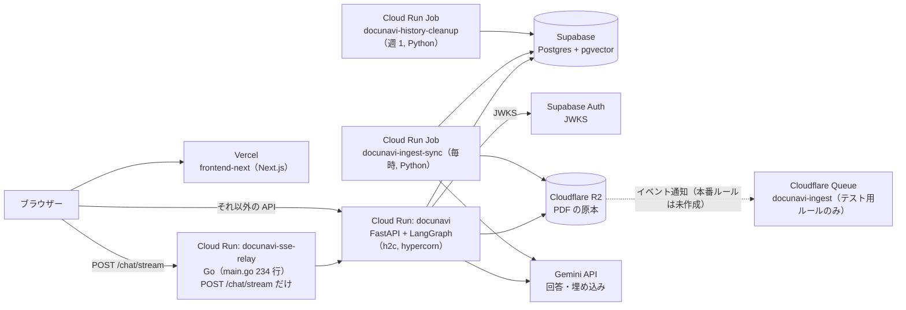

# Go 化計画（アプリ全体の役割分担）

この文書は、`app/` と `ops/` を役割ごとに分け、**どこを Go にし、どこを Python のまま残すか**を決めるための計画です。**実装の契約ではなく、コードも本番も変えていません。**
利用者の方針変更（2026-10-25）に基づきます: Go を学習用の部品に留めず、SSE・入口・Queue の制御・運用ツールを担う、中核のサービス言語の一つとして位置づける。
一括の置き換えはしない。小さく、境界のはっきりした所から、旧実装と比べられる形で移す。

関連: 今の構成は [architecture.md](architecture.md)、採用の条件と学習の目的は [target-architecture.md](target-architecture.md)、Queue は [r2-ingest-design.md](r2-ingest-design.md)、中継は [../ops/sse-relay/README.md](../ops/sse-relay/README.md)。

## 0. 先に断っておくこと

- **性能・安定性の根拠はまだ薄い。** Go の中継について測ったのは、疑似 SSE の 1 台・ループバック（証拠等級 A、各 1 回）と、本番での 1 回ずつの疎通・切断の確認だけ。
  「Go の方が速い」「Go にすれば安定する」とは**言えない**。この計画が Go を置く理由は、(a) 長い接続・並行処理・小さな運用ツールという用途に Go が向くという一般的な設計判断（証拠等級 C）と、
  (b) 利用者が決めた、学習と将来の接続数増加への備え、の 2 つ。製品として今すぐ必要になった、という根拠ではない。
- [target-architecture.md](target-architecture.md) の「採用条件」（同時 SSE 数が測った容量を超える、など）は、**製品の必要から採用する場合**の基準で、今はどれも満たしていない。
  同文書の「目的」と「採用条件」の注記のとおり、**学習のために利用者が決めたときは、満たさなくても採用できる**。この計画はその枠で動く。条件を満たしたとは書かない。
- この文書にある数字は、確認した場所（コード・Cloud Run の設定・測定の記録）を付けて書く。付けられないものは「未確認」と書く。

証拠等級: A = 実機・実測で確認 / B = 公式の文書 / C = 第三者の記事・別の AI の回答・一般論 / 不明。

## 1. 現在の構成

- 画面から API への経路は 2 つ。`/chat/stream` だけが中継を通り、それ以外（`/chat`、`/threads`、`/documents` など）は API へ直接届く（`NEXT_PUBLIC_STREAM_BASE_URL` は Vercel の Production だけ。[../ops/sse-relay/README.md](../ops/sse-relay/README.md)）。
- Cloud Run の設定（2026-10-25 に読み取り専用の gcloud で確認。証拠等級 A）:

| 項目 | `docunavi`（API） | `docunavi-sse-relay` |
|---|---|---|
| ポート | 8080（名前 `h2c`） | 8080（名前 `h2c`） |
| タイムアウト | 90 秒 | 120 秒 |
| 同時実行 / 最大台数 | 20 / 2 | 20 / 2 |
| CPU / メモリ | 1 / 512 MiB | 1 / 256 MiB |
| サービスアカウント | `docunavi-run` | `docunavi-run`（同じ。**中継は環境変数も Secret も持たないのに、API と同じ権限**） |
| Secret の参照 | `gemini-api-key` `gemini-api-key-paid` `database-url` と、ボリューム `/secrets/r2` | なし |
| 最小台数 | 0 | 未設定（0 と思われる。未確認） |

- コードの量（行数。`wc -l`）: `app/` 約 7,000 行（Python）、`ops/sse-relay/main.go` 234 行 + テスト 426 行。テストは `tests/` に pytest 多数（Go のテストは `go test` で、CI は `ops/sse-relay` を**含まない**）。

## 2. 役割ごとの分解

「外部」は外へ出る通信、「DB」は触る表、「Secret」は実行時に要る秘密。テスト件数は `def test_` の数（同じ語を含むファイルの合計。おおよその目安）。

| # | 役割 | 実装 | 外部 | DB | Secret | テスト | 配備 |
|---|---|---|---|---|---|---|---|
| 1 | SSE の入口（中継） | `ops/sse-relay/main.go`（Go） | 上流の API（h2c） | なし | なし | Go 単体（`main_test.go`） | Cloud Run `docunavi-sse-relay` |
| 2 | `/chat` `/chat/stream` の処理 | `app/api/routes.py` 462 行（入力検証、切断の監視、エラーの分類）、`app/api/ui_stream.py` 145 行（AI SDK の UI message stream への変換） | Gemini | チェックポイント | 2 の API と同じ | 約 60（`test_chat*`）+ `test_hedged_stream` ほか | Cloud Run `docunavi` |
| 3 | 回答の生成（グラフ） | `app/agents/graph.py` 624、`resilience.py` 835（ヘッジ・フォールバック・有料キー切り替え）、`tools.py` | Gemini（langchain-google-genai） | チェックポイント | Gemini キー（無料・有料） | `test_llm*` 約 130、`test_key_switch` 27 ほか | 同上 |
| 4 | ガードレール | `app/agents/guardrails.py` 270（ルールベース。ストリーミング用の `StreamingOutputGuard` を含む） | なし | なし | なし | 約 30 | 同上 |
| 5 | 認証 | `app/auth.py` 288（JWKS の取得・キャッシュ、ES256/RS256 の検証、`sub` から履歴のキー） | Supabase の JWKS | なし | なし（公開鍵） | 40 | 同上 |
| 6 | 会話履歴・会話の一覧 | `app/history.py` 136、`app/api/threads.py` 213（LangGraph の Postgres チェックポインタ） | なし | `checkpoints` 系（LangGraph が作る表） | `database-url` | 約 60 | 同上 |
| 7 | 履歴の保守 CLI | `app/history_admin.py` 100（SQL のみ。LangGraph を読み込まない） | なし | `checkpoints` 系 | `database-url` | 5 | Cloud Run Job `docunavi-history-cleanup`（同じ API イメージ `cc5709c`） |
| 8 | 資料の検索 | `app/search_vector.py` 232（質問の埋め込み → pgvector） | Gemini（埋め込み） | `chunks` | Gemini キー、`database-url` | 約 30 | 同上 |
| 9 | 資料の一覧・原本 | `app/api/documents.py` 235、`app/pdf_originals.py` 155、`app/r2_store.py` 345 | R2（S3 互換。boto3） | `documents` `chunks` | `database-url`、`r2-app-read` | 約 17 + R2 約 100 | 同上 |
| 10 | 条文の関係図（実験） | `app/api/graph.py` 189、`app/relations/` 約 400 | R2 / 原本 PDF | `documents` | 同上 | 約 40 | 同上 |
| 11 | PDF の取り込み | `app/ingestion/pdf_parser.py` 281（pypdf）、`chunker.py` 433、`service.py`、`repository.py` | なし | `documents` `chunks` | `database-url` | 約 130 | Job（下の 13） |
| 12 | 埋め込みの生成と保存 | `app/ingestion/embedding.py` 248、`embed.py` 101 | Gemini（埋め込み、課金あり） | `chunks` | Gemini キー、`database-url` | 約 30 | Job |
| 13 | 取り込みの制御（毎時の突き合わせ） | `app/ingestion/sync.py` 129（資料群を巡り、取り込み → 埋め込みの順に呼ぶ。終了コードの判断） | R2 | 11・12 経由 | `database-url` `gemini-api-key` `r2-app-read` | 15 | Cloud Run Job `docunavi-ingest-sync`（イメージ `docunavi-ingest:a983807`） |
| 14 | 取り込みの制御（Queue） | `app/ingestion/queue_worker.py` 418（Queue から pull、メッセージの検査、ack/retry の判断） | Cloudflare Queues の REST、R2 | 11・12 経由 | 上の 3 つ + `ingest-queue-token` | 36 | **未配備**（B4 でイメージ、B5 で Job） |
| 15 | 運用の Job | `ops/r2_key_issuer`（664 行）、`ops/r2_wire`（429 行）、`ops/budget_guard`（72 行） | Cloudflare / Cloud Run / Billing の API | なし | 各々 | `test_r2_key_issuer` `test_r2_wire` `test_budget_guard` | Cloud Run Job、Cloud Run functions |
| 16 | 検索の MCP サーバー | `ops/mcp_search/main.py` 150（`app.search_vector` を使う） | Gemini | `chunks`（読み取り専用ロール） | `database-url-readonly` `gemini-api-key` | 13 | Cloud Run `docunavi-mcp`（非公開） |
| 17 | 画面 | `frontend-next/`（Next.js） | API | なし | 公開用の値のみ | 単体 + E2E | Vercel |

境界の性質で見ると、次の 3 つが重要。

1. **LangGraph が持つ形式は Python の中にある。** 会話履歴（6）は LangGraph のチェックポインタが作る表で、保存形式のシリアライズ（バイナリ）を Python のライブラリが読み書きする。会話の本文を取り出す `/threads/{id}/messages` も同じ。
   SQL だけで済むのは「一覧の件数と時刻」「古い会話の削除」だけ（7 がそうなっている）。
2. **3・8・11・12 は Gemini と PDF の内部で閉じている。** 回答の生成、質問と文書の埋め込み、PDF の解析は、Python のライブラリ（langchain、pypdf）に寄っていて、Go に移す利点より、書き直しの費用と、旧実装との差の検証の負担が大きい。
3. **すでに「プロセスの境界」に近い契約がある所が、移しやすい。** 13・14 は、取り込みを `python -m app.ingestion` の**終了コード**（0・3 = 完了、1 = 一時的な失敗、2 = 設定の誤り）と標準出力で呼んでいる。制御（Queue・タイマー・ack/retry・タイムアウト）と処理（PDF → DB）の間が、すでに分かれている。

## 3. 分類

| 区分 | 役割 | 理由 |
|---|---|---|
| **Go（すでに Go。育てる）** | 1 SSE の入口 | 長時間接続・切断の伝播・接続数の制御が主題で、Go の標準ライブラリで足りている。監査と改善は §4。 |
| **Go へ移す候補（比較してから）** | 14 Queue の制御（B5 の後）、7 履歴の保守 CLI、13 突き合わせの制御（14 とまとめて） | 境界（終了コード・SQL だけ）がはっきりしている。ただし**移す価値は未測定**で、旧実装と並べて比べる（§6）。 |
| **Go へ移す候補（今は決めない）** | 5 認証（入口での検証）、9 資料の一覧・原本（読み取り専用 API） | 入口に置くと「中継を通らない経路」との二重化・信頼の境界の変更が生じる（§5）。先に 1 の改善と、入口の役割の決定が要る。 |
| **Python のまま残す** | 3 回答の生成、4 ガードレール、8 検索、11 PDF 解析・チャンク化、12 埋め込み、2 `/chat` `/chat/stream` の処理、6 会話履歴・一覧、10 関係図、16 MCP | LLM・埋め込み・PDF・LangGraph のライブラリが Python に寄っている。4 はストリーミングの状態を 3 と共有する。6 は LangGraph の保存形式。 |
| **今は移さない** | 15 運用の Job（鍵の発行・Cloud Run の切り替え・予算の停止） | 動いていて、触る頻度が低く、書き換えの利得が学習だけ。壊したときの影響（鍵・課金・本番の切り替え）が大きい割に、得るものが小さい。必要になったら再検討する。 |
| 対象外 | 17 画面 | Next.js のまま。 |

## 4. 中継（`ops/sse-relay/main.go`）の監査

利用者の指示の「役割」に対して、`main.go`（2026-10-25 時点）を読んだ結果。区分: ✔ 実装あり（確認の程度つき）/ △ 一部 / ✗ 無い。

| 役割 | 状態 | 根拠 |
|---|---|---|
| `/chat/stream` を API へ中継する | ✔ 本番で確認（各 1 回、等級 A） | 本番の実質問で 200（約 3.0 秒）、CORS の `OPTIONS` 200。同時 2 本の疎通 |
| クライアント切断を上流の取り消しまで伝える | ✔ 本番で 1 回確認（等級 A） | 切断の 21 ms 後に API が取り消しを記録。生成の終盤だった可能性があり、**提供元で生成・課金が止まったことは未確認**。ローカルの疑似 SSE では 1〜3 ms で伝播（20/20） |
| バッファせず即時に flush | ✔ | `FlushInterval = -1`、`X-Accel-Buffering: no`。単体テストあり。**本番での逐次表示は、長い回答では未確認**（roadmap の「未確認」） |
| 上流のタイムアウト | ✗ | `ReadHeaderTimeout 10s`（受信側）だけ。上流への接続・応答ヘッダー待ちの期限が無い（`http.DefaultTransport` の 30 s の接続期限のみ）。上流が応答しないとき、Cloud Run の 120 秒まで待つ |
| 下流の書き込みタイムアウト | △ 意図して無し | `WriteTimeout` は付けない（長い SSE を切らないため）。遅い・止まった受け手を切る仕組みは無い |
| アイドルタイムアウト | ✗ | 本文が止まったままでも、`: ping` を送り続け、上流が止まっているのか生きているのか区別せず待つ。上流が `: ping` を送り続ける限り、実質いつまでも開いている（上限は Cloud Run の 120 秒） |
| 接続数・同時実行数の制御 | ✗ | 上限なし。Cloud Run 側の `containerConcurrency 20`・最大 2 台が事実上の上限（それを超えた要求は Cloud Run が受け付ける側で待たされる〔挙動は未確認〕） |
| 観測性（接続数・エラー率・遅延をログ・メトリクスで） | ✗ | 標準の `log` による文字列のログのみ。リクエストごとの記録（開始・終了・状態・所要時間・切断の理由）が無い。メトリクス無し。Cloud Logging が付ける request ログに頼っている |
| 上流が失敗したときの SSE 上の `error` イベント | ✗ | `ErrorHandler` が **本文なしの 502** を返す。画面は HTTP の失敗として扱う（フロントの扱いは `frontend-next/src/api/chat.ts`。**本ファイル作成時には読んでいない**）。ヘッダー送信後（途中）の上流の失敗は、接続が閉じるだけ。**既知の課題:** 上流に届かず 502 を返した後、同じ HTTP/1.1 の接続を使い回した次の要求が "connection reset" になることがある（ローカルの単体テストで 60 回中 52 回。上限の有無に関係しない）。原因は 502 のとき要求本文を読まずに閉じるためと推測（未検証）。本番のブラウザー〜中継は HTTP/2 のはずで影響は未確認。直さず記録のみ。実 API の段階 1b で確認する |
| ヘルスチェック | ✗ | `/healthz` 等が無い（`/chat/stream` 以外は 404）。Cloud Run の起動確認は TCP |
| 最小権限 | ✗ | `docunavi-run`（API と同じ SA）で動くが、中継は Secret も DB も要らない |
| 本文サイズの上限 | ✗ | 付けていない（README の「未確認」） |
| CI | ✗ | `ci.yml` は `ops/sse-relay` の `go vet` / `go test` を回さない |

### 改善の項目（優先度順）

どれも `/chat/stream` の挙動を変えない、または変えても小さい範囲から。各項目は**実行前に、コマンドと影響を示して承認をもらう**（この文書は提案）。

| 優先 | 項目 | 変更内容 | 確認方法 | 影響範囲・戻し方 |
|---|---|---|---|---|
| P1 | リクエストごとの構造化ログ | 開始・終了の 1 行（JSON。Cloud Logging の `severity` `message` 形式）。項目: 経路、状態、上流の状態、所要時間、送ったバイト数、終了の理由（完了 / クライアント切断 / 上流の失敗 / 期限）、`thread_id`（本文は読まないので、ヘッダーかパスからは取れない。**取れない場合は付けない**）。内容・認証ヘッダー・本文は出さない | `go test`。ローカルで API と一緒に起動し、ログの形と、切断・完了・上流停止の各ケースを目で確認 | `main.go` のみ。配信は Cloud Run の新リビジョン（0% で作って確認できる）。戻しは前のリビジョンへ |
| P1 | 上流のタイムアウトの明示 | `ResponseHeaderTimeout`（上流が最初のバイトを返すまで）、上流への接続期限。値は API の `LLM_TIMEOUT_SECONDS`（60）・Cloud Run の 90 秒と整合させる（鎖は §5） | `go test`（遅い上流の疑似）。**本番の最初のチャンクまでの実測（22〜31 秒）を超えない値**にする必要があり、決める前に最近のログで分布を読む | 長い待ちを切る可能性がある。値を誤ると正常な質問を切る。戻しは前のリビジョン |
| P1 | CI に Go のジョブ | `go vet` `go test -race` を `ci.yml` に足す | CI の結果 | `ci.yml`（利用者の承認が要る。CLAUDE.md の運用） |
| P2 | 接続数の上限と計数 | 同時接続を数え、上限を超えたら 503 + `Retry-After`。ログに現在数。上限は環境変数 `MAX_CONCURRENT_STREAMS`、**既定は 100**（0 で無制限）。超えた要求は待たせず 503 で断る。断る応答の CORS は許可リスト（`CORS_ORIGINS`）のオリジンだけ。コードは作成済みで未配備（本番の Cloud Run の同時実行数は 20 なので、配備しても 100 には届かず、効くのは試験用サービスだけ） | `go test`（並行）。疑似 SSE で上限の前後 | 上限を低くしすぎると利用者を弾く。Cloud Run の `containerConcurrency` との関係を決めてから |
| P2 | 上流が失敗したときの意味のある応答 | ヘッダー送信前の失敗は、画面が理解できる形（既存の `data-failure` + `error` チャンク、または固定のエラー）で返す。**画面側の処理の確認が先**（`chat.ts`） | `go test` + 画面（モックの上流で 502 を返す）。フロントの変更が要るなら別の承認 | 画面の挙動が変わる。HTTP 502 のまま扱う現状の挙動と比べる |
| P2 | 専用のサービスアカウント | 中継だけの SA（権限なし。Secret・DB に届かない）に切り替える | `gcloud run services describe` で SA を確認。疎通 1 回 | 配備の変更（利用者が実行）。戻しは SA を元に戻す |
| P3 | アイドルの期限 | 上流が本文も `: ping` も送らない時間が一定を超えたら切る（API の `: ping` は 10 秒ごと。中継の 25 秒の ping と区別して測ってから） | 疑似 SSE | 誤って切らない値の根拠が要る |
| P3 | ヘルスチェック・メトリクス | `/healthz`（`/chat/stream` 以外を 404 にした設計との関係を決める）。Cloud Run の既定のメトリクスで足りない分だけ | 疎通 | 中継の公開面が増える |
| P3 | 本文サイズの上限 | `http.MaxBytesReader`（API の入力検証の上限と合わせる） | `go test` | 小さい |

### 同時接続の目標（段階。利用者の方針、2026-10-25）

同時接続を本気で想定する、という方針に合わせ、中継の性能目標を段階で置く。**目標は「測って確かめる対象」で、達成済みではない。** 各段階の測定・設定変更は、実行前に承認を取る。

| 段階 | 目標 | 測定方法 | 状態 |
|---|---|---|---|
| 現状 | 利用者が少なく、同時接続の効果は出ていない | — | 本番の同時接続は最大 2 本の疎通を 1 回確認しただけ |
| **1（最初の試験目標。利用者の決定）** | **100 同時 SSE を 1 インスタンスで安定して保持し、切断と上限を正しく扱う** | **疑似の上流**（LLM を呼ばない固定メッセージをゆっくり流す）で、まずローカル、次に Cloud Run の中継。詳細は下の「段階 1 の試験の設計」 | 未実施（設計のみ） |
| 1b | 実 API で 5〜10 接続。切断の伝播とエラー処理だけ確かめる | 実際の質問（無料キー。課金・429 の可能性）。**別途承認** | 未実施 |
| 2 | 500 同時 SSE で、インスタンス数・メモリ・コストの増え方を測る | 同上。段階 1 が通ってから。`containerConcurrency` と最大台数を変えて比べる | 未実施・今は始めない |
| 3 | 1,000 同時 SSE で、接続上限・背圧・上流が落ちたときの挙動を確かめる | 同上 + 上流を途中で止める | 未実施・今は始めない（ローカルの疑似 SSE の 1000 本は測定済み。[target-architecture.md](target-architecture.md)） |

100 を最初の目標にする理由（利用者の決定。20 では Go の効果が見えにくく、500 は大きすぎる、という判断）。「100 超で専用 gateway が要る」という一般論は、第三者の記事・別の AI の回答に基づく（証拠等級 C）で、**この製品で成り立つかは、この試験で確かめる対象**。

### 段階 1 の試験の設計（100 同時 SSE。疑似の上流）

**前提の変更が要るもの（どれも実行前に承認）:**

1. **中継に同時接続の上限を足す**（§4 の P2）。無いと「101 本目の拒否」を確かめられない。上限は環境変数で、既定は 100（コードは作成済み・未配備）。試験でもこの値。
2. **試験用の疑似の上流**を用意する（LLM・DB・認証なし。本物の API は 100 本同時に叩かない: Gemini の制限と費用、API の枠 40 本が先に問題になる）。`ops/sse-relay/bench/sse_upstream.py` は旧経路（`GET /stream`）向けなので、`POST /chat/stream` 用に直すか、新しく作る。
3. **Cloud Run で測る場合の設定:** 試験用の中継サービス（本番の `docunavi-sse-relay` とは別名。本番の経路に触れない）を、`containerConcurrency` ≥ Go 側の上限、**最大台数 1** で作る。台数が 2 以上だと、101 本目は 2 台目に回り、拒否を確かめられない。Cloud Run の同時実行数が Go の上限と**同じ**だと、101 本目は Go に届く前に Cloud Run が待たせる（挙動は未確認）ので、Go の上限より少し大きくして、拒否を Go 側で起こす。
4. **負荷の道具:** 今あるのは `ops/sse-relay/bench/bench.py`（Python。1000 本まで測った実績あり）だけ。k6 などの新しい道具の導入は、入れる前に承認を取る（開発コンテナには入っていない）。

**手順:** 10 → 25 → 50 → 75 → 100 本を段階的に上げ、各段階を 2〜5 分保つ。その後、接続の切断・再接続を混ぜた区間（connection churn）を追加し、最後に 101 本目を足して拒否を見る。

**測るもの:** アクティブ接続数、中継のピークメモリ、CPU、最初のイベントまでの時間、イベントの遅延の p95 / p99（直結と比べる）、クライアント切断から上流が止まるまでの時間、エラー率・切断率、101 本目の挙動。

**合格基準（案。実測の前に利用者が確認する）:**

| 項目 | 基準 |
|---|---|
| 保持 | 100 本を 5 分間、切れずに保てる |
| メモリ | 現在の 256 MiB のインスタンスで OOM しない。ピークは数字で記録する（ローカルでは 1000 本で 85〜94 MB、A。Cloud Run では未測定） |
| 遅延 | 直結（中継なし）と比べて、最初のイベントまでの時間・イベントの遅延の p95 が大きく悪化しない（「大きく」の数字は、直結の測定を取ってから決める） |
| 切断 | 切断後、上流の疑似 SSE が停止する（ローカルでは 1〜3 ms、A）。本物の LLM の取り消しは段階 1b で確かめる |
| 上限 | 101 本目が 503（または SSE の `error`）で明確に拒否される |
| 継続 | 切断・再接続を混ぜても、メモリが増え続けない |

**この試験でも言えないこと:** 本物の LLM 生成が 100 本同時に通ること（API は最大 2 台 × 同時 20 = 40 本）。本番の経路（ブラウザー → Vercel → 中継）の性能。Cloudflare Worker を挟んだときの挙動。

この目標を置くときに、先に押さえておくこと（読んだ設定と測定記録から。証拠等級は各項目に付ける）。

- **「500 本を超えると効果が出る」という記録は、条件つき。** 測ったのは、疑似 SSE・ループバック・1 回で、**直接の hypercorn が 500 本を超えると最初のバイトまで約 1 秒になり、中継を挟むと 150 ms 台に収まった**こと（A）。LLM・認証・Cloud Run を含まない。実際の API は LLM の待ちで 1 本あたり数十秒かかるので、同じ効果が出るかは未確認。
- **中継は接続を受けるだけで、API の同時処理は増えない。** 中継は 1 本の SSE につき 1 本の上流（API）の要求を持つ。今の API は最大 2 台 × 同時 20 = **40 本**（Cloud Run の設定、A）で、各要求は Gemini の応答が終わるまで枠を使う。中継を Go にしても、**API 側の枠と Gemini の呼び出しの上限（無料キーは 429 になる）が、全体の同時数を決める**。
  したがって「500 同時」は、(a) 中継の層だけを疑似の上流で測る目標としては意味があるが、(b) 実際の質問を 500 本同時に通す目標としては、API の台数・同時数の設定と Gemini の割り当てを変える別の判断が要り、**この計画の範囲を超える**（費用と 429 を伴う）。
- **中継の Cloud Run の設定は、そのままでは 500 に届かない。** 現在 `containerConcurrency 20`・最大 2 台 = 40 本。500 を測るには、同時実行数か最大台数を上げる必要がある（メモリ 256 MiB で足りるかは未確認。ローカルの 1000 本では中継が 85〜94 MB だった、A）。Go 側の実装の上限と Cloud Run の同時実行数を**一致させる**（Cloud Run の値だけを上げない）。
- **コストの主張はしない。** 「Go にするとインスタンス数・コストが下がる」は、API を Python のまま残す限り、**中継の層でしか言えない**。中継が増える分、サービスが 1 つ増える。削減になるかは、段階 2 の測定の後に初めて書ける。
- **切断伝播は Python でも本番で確認済み**（h2c + hypercorn。roadmap ②、A）。「切断を上流まで伝えるのは Python では難しい」は当てはまらない。中継が足すのは、接続の層での追跡・制御で、切断伝播の有無ではない。
- **測定の費用:** 疑似の上流なら、Gemini を呼ばず課金は起きない。実際の質問を使う負荷試験は、課金と 429 を伴うので、別途承認を取る（CLAUDE.md の「実 API の呼び出し」）。

要件として追加するもの（§4 の P2 に含める）: 同時接続数の上限（超過時は 503 + `Retry-After`、または SSE の `error`）、1 接続あたりのメモリの目標（段階 1 の測定で決める）、アクティブ接続数・切断数・p95/p99・エラー率のログまたはメトリクス、Cloud Run の `containerConcurrency` と Go 側の上限の一致。

測るもの（改善の前後で記録する）: 最初のバイトまでの時間（中継あり・なし）、切断が API に届くまで、同時 N 本のとき。**中継を通すことで最初の応答までの体感が悪化しないか**は、指示の判断基準の 1 つで、現状は本番で 3.0 秒（1 回）の記録しかない。

## 5. 入口（gateway）の役割と、決めておくこと

利用者の理想形では「API gateway / SSE 入口: Go」。現状の中継は `/chat/stream` だけで、gateway ではない。gateway にする前に、次を決める。**決めずに進めない。**

1. **認証をどこで検証するか。** 今は API が全リクエストで JWT を検証する（5）。API（Cloud Run）は**公開**で、中継を通らない経路もある。入口で検証を足しても、API の検証は外せない（外すと、`*.run.app` へ直接来る経路が無防備になる）。
   外すには「API を非公開にして、入口からだけ呼べるようにする」（Cloud Run の IAM、または共有ヘッダー）が前提で、これは [target-architecture.md](target-architecture.md) の Worker の「秘密ヘッダー」の話と重なる。**重複して二重に検証するだけなら、利点は小さい**（Django の測定で、検証は 1 回約 70 µs。差は実質ない）。
2. **入口にどの経路を載せるか。** `/chat/stream` 以外（`/threads` `/documents`）を載せると、画面の API の向き先が 1 つになる反面、中継が止まると全部が止まる（今は SSE だけ）。
3. **Cloudflare の Worker との関係。** [target-architecture.md](target-architecture.md) では、独自ドメインの後に Worker を前段に置く決定（未実装）。Go の入口と Worker の役割が重なる。ドメインが決まる前に入口を広げるのは、二度手間になりうる。
4. **タイムアウトの鎖。** LLM 60 秒（`LLM_TIMEOUT_SECONDS`）< API の Cloud Run 90 秒 < 中継の Cloud Run 120 秒（今の設定）< Cloudflare の 125 秒（Worker を入れたとき）。中継の期限は上流より長く、その外側より短い、という順になっているか、値を決めるときに確かめる。

## 6. 移行の順序

**原則:** 旧実装を残したまま、新実装を並べて動かして比べる。新実装に切り替えるのは、旧実装と同じ入力に同じ出力が出ると確かめてから。切り替えは 1 つずつ、承認を取って行う。いつでも前の状態に戻せること。

| 段階 | 内容 | 前提 | 確認方法 | ロールバック |
|---|---|---|---|---|
| 0 | この計画の作成（済み） | — | 利用者のレビュー | 文書を消す |
| 1 | 中継の改善（§4 の P1 → P2 → P3 の順に、1 項目ずつ） | 各項目で承認 | §4 の確認方法。本番では 0% の新リビジョンを作って疎通を見てから切り替える | Cloud Run の前のリビジョンへ |
| 2 | B4・B5（Python の `queue_worker`）を予定どおり配備 | 利用者の承認（B4 のビルド待ち） | [r2-ingest-design.md](r2-ingest-design.md)、手動 1 回の実行 | Job の削除 |
| 3 | Queue 制御の Go 版を**比較用に**作る（本番の Job は変えない） | 2 の安定（手動実行・失敗系・hourly sync との関係を観察） | 同じメッセージ（`tests/test_ingestion_queue_worker.py` の 36 件が仕様）を両方に流し、ack / retry / 破棄の判断と終了の挙動が一致すること。Go 版は ack せず判断だけ出す「ドライラン」から | Go 版を消すだけ（本番に載せていない） |
| 4 | 履歴の保守 CLI の Go 版（7）を比較用に作る | 3 と独立 | 同じ DB（テスト用の Postgres）で、削除対象の件数が一致 | 同上 |
| 5 | 入口の役割の決定（§5） | 1 の成果、ドメインの有無 | 決定の記録 | — |
| 6 | 5 の決定に基づき、載せる経路を 1 つずつ増やす | 5 | 経路ごとに旧経路と比較 | `NEXT_PUBLIC_*_BASE_URL` を外す（今のところ、外す操作は私からはしない） |

**段階 3 以降は、各々「やる・やらない」を利用者が決める。** 3 を始める条件の「2 の安定」は、観察の期間と回数を、B5 の後に決める。

### B4〜B5 の `queue_worker` を「Go に置き換えやすい形」で進めるために

Python のまま進める。次を守ると、段階 3 が楽になる。**どれも新しいコードを足さない（いまある形の確認と文書化）。**

- **契約を固定する。** メッセージの入力（バケット・action・キーの形・大きさ）、処理結果 → ack / retry / 破棄の対応、終了コード（0・3 = 完了、1 = 一時的な失敗、2 = 設定の誤り）、環境変数（`INGEST_QUEUE_ID` `INGEST_QUEUE_TOKEN` ほか）。`queue_worker.py` の説明文とテスト 36 件がすでに仕様になっている。
- **Job の設計は、処理を呼ぶ側と処理する側を分けたまま。** `queue_worker` は取り込み（`python -m app.ingestion`）と埋め込みを**呼ぶだけ**で、本体を持たない。Go 版に替えるなら、制御だけを Go にし、処理は `python -m app.ingestion …` の呼び出し（同じイメージの中）で残せる。
- **Job の定義を、実装に依存させない。** B5 では Job の引数・SA・タイムアウトを、`docunavi-ingest-queue` という名前と、固定の引数で作る（実行時の上書きは使わない）。Go 版を載せるときは、イメージとコマンドの差し替えだけで済むようにする。
- **状態は DB に置き、Queue に持たせない。** 今の設計どおり（通知は合図で、冪等）。Go 版も同じ前提でよい。

Go 版を載せるときの注意（比較してから判断）: Python の取り込みを呼ぶ以上、**イメージに Python も要る**（Go だけの小さいイメージにはならない）。それなら Go に替える利点は、制御の並行処理・観測性・起動の速さといった、学習と運用の面に限られる。製品の利得は期待しない。

## 7. リスク

| リスク | 対処 |
|---|---|
| 入口を経由する経路が増え、中継の障害が全体の障害になる | §5 で経路を決めるまで、`/chat/stream` だけに留める。経路を増やすときは、旧経路（直接）を残す |
| 二重化（検証・タイムアウト・CORS）で、どこが正かが分からなくなる | 役割ごとに「一次の持ち主」を表にして残す（§5 の決定時） |
| 言語が増え、保守・CI・配備の手間が増える | Go は標準ライブラリだけ（依存を足さない）で始める。CI に Go を入れる（§4 P1）。イメージ・Job を増やすたびに利用者の承認を取る |
| 比較なしの書き換えで、本番の挙動が変わる | 段階 3 以降は旧実装と並べる。本番の Job・サービスは、比較が済むまで変えない |
| 中継の SA が過大（`docunavi-run`） | §4 P2。専用 SA へ（利用者が実行） |
| 根拠のない主張を書く | 測定済み / 本番確認済み / 未確認を分けて書く（§8）。この文書の更新時も守る |

## 8. 測定済み・本番確認済み・未確認

| 区分 | 内容 |
|---|---|
| 測定済み（A。開発コンテナの疑似 SSE、各 1 回） | 1000 本の同時接続で全構成エラー 0。中継が足す遅延は数 ms。切断は 1〜3 ms で上流に届く（20/20）。中継のメモリは 85〜94 MB。詳細: [target-architecture.md](target-architecture.md) の「Go の SSE 中継の測定」 |
| 本番で確認済み（A。各 1 回） | 実質問が中継経由で 200（3.0 秒）。CORS の `OPTIONS` 200。同時 2 本が 200 + `[DONE]`。切断の 21 ms 後に API が取り消しを記録 |
| 一般論（C。未検証） | Go は gateway・SSE・worker・CLI に向き、Python は AI・データ処理に向く。この計画の分担はこの考え方に沿うが、**この製品で効果があるかは測っていない** |
| 未確認 | 中継の `: ping`（API の 10 秒ごとの ping と区別がつかない）。長い回答の逐次表示（本番）。接続数の負荷の上限。本文サイズの上限。モデル提供元での生成停止・課金停止。中継を通すことでの体感遅延の差（本番で比較していない）。Cloud Run が上限を超えた要求をどう扱うか。画面が 502 をどう扱うか（`chat.ts` を読んだ結果: 502 と 503 は文言で出る。503 は本文の日本語の `detail`、502 は汎用の文。実機では未確認） |
| 判断が済んでいない | 入口の範囲と認証の置き場（§5）。段階 3 以降をやるか。同時接続の段階目標（§4）の測定を始めるか、実際の質問での負荷試験をやるか（課金・429 を伴う） |

## 9. 次に承認が要るもの

この計画に基づく**どの変更も、まだ始めていない**。次の順で、1 つずつ承認を取る。

1. この計画の方向でよいか（特に §3 の分類と §6 の順序）。
2. 段階 1 の最初の項目（P1: 構造化ログ）。コマンドと影響を示してから。
   100 同時接続の試験（§4）は、(a) 中継の接続数の上限（P2）、(b) 疑似の上流、(c) 試験用サービス（最大台数 1）の作成、(d) 負荷の道具、の順に、それぞれ承認を取る。合格基準の数字は、直結の測定を取ってから確定する。
3. B4（ビルド）の実行結果の確認、B5 の Job の作成（Python のまま）。
